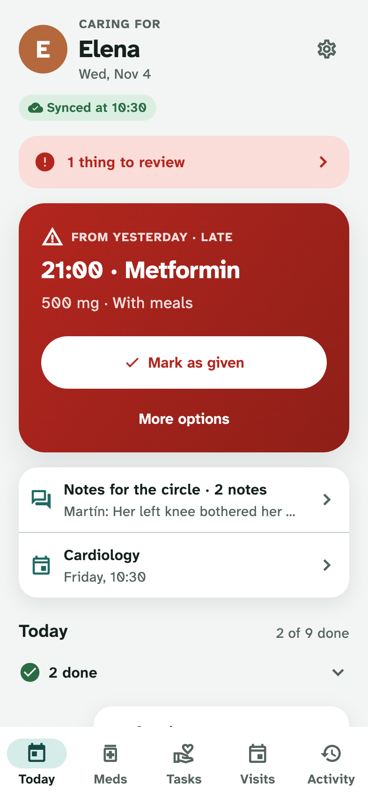
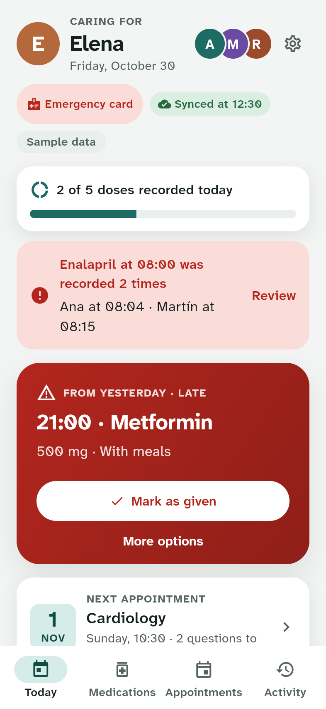
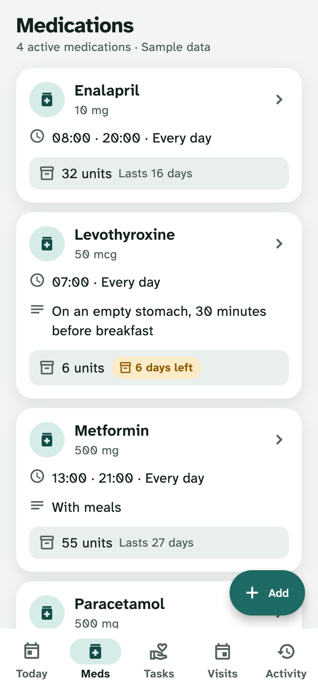
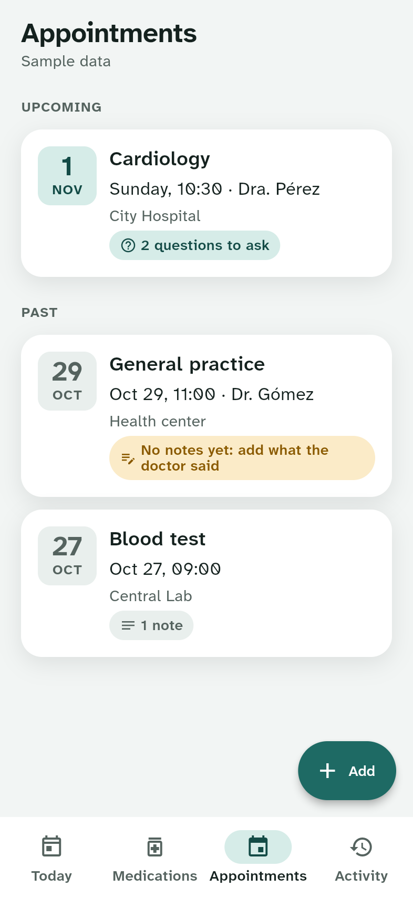
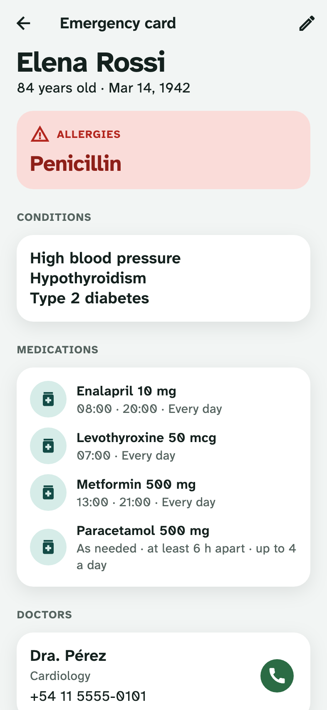
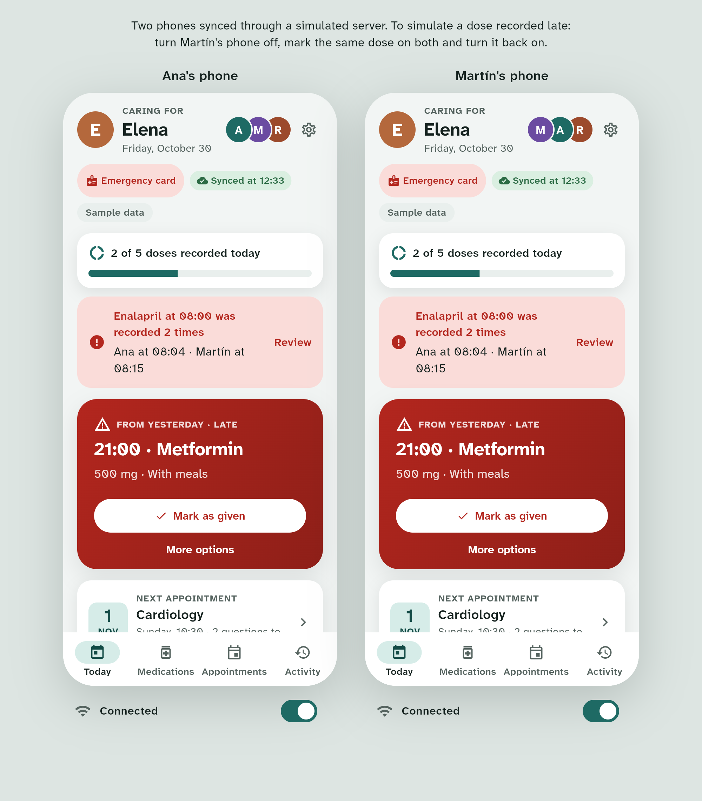

# ICare

[](https://github.com/gryllifish/i_care/actions/workflows/ci.yml)
[](LICENSE)

A Flutter app for siblings, partners and paid carers who share the care
of an older relative: which medications they take, whether today's doses
were given, by whom and when, how many pills are left, and upcoming
doctor's appointments. It works offline and syncs between phones.

[Live demo](https://gryllifish.github.io/i_care/) (web build; on a desktop
it shows two caregivers' phones side by side, synced through a simulated
server).

| Today | Given twice | Medications | Appointments | Emergency card |
|:---:|:---:|:---:|:---:|:---:|
|  |  |  |  |  |



**ICare does not give medical advice.** It records what caregivers do.
Every warning cites values entered by the user. Follow the instructions
of the treating doctor or pharmacist.

## Features
- **Today:** the next dose first, then the day's doses with their status
  (due, late, given by whom and when, skipped and why). Unresolved doses
  from yesterday stay visible. Undo for a few seconds after recording.
- **Warnings before a dose:** already given, too soon after the last
  one, or this phone hasn't synced in a while. Doses can be recorded
  late ("given an hour ago").
- **Doses given twice** from two phones are flagged on both and reviewed
  step by step, never merged away.
- **Medications:** fixed times on chosen weekdays or as needed (minimum
  interval, maximum per day). Schedule changes apply from a date and
  keep earlier versions. Stock is counted, refilled and consumed by
  doses, with a low-stock alert by days left.
- **Care tasks:** what isn't medication, like a bath, a walk or a skin
  check, at set times or during the day, on chosen weekdays. They join
  the doses on Today and are marked done or not done (with a reason).
  Unlike doses, a task done twice is never flagged.
- **Appointments:** links to studies and results kept with each visit,
  questions to ask beforehand, visit notes from several
  caregivers afterwards, and a nudge when a past visit has no notes.
- **Emergency card:** allergies, conditions, medications, doctors and
  contacts on one screen, with call buttons and "Copy as text".
- **Handoff summary:** what was given, what is pending and what's next,
  copied as plain text for a chat message.
- **Activity:** the shared log of everything that happened, by day.
- **Roles:** admins, daily caregivers, occasional helpers and view-only
  relatives, each offered only what their role allows, while the server
  checks every event. Phones join by one-time invitation codes. An
  admin's Today sums up the day instead of asking them to record; a
  helper's app is today's care only, and their phone never receives the
  team's appointments, notes or documents.
- English and Spanish, a light and a dark theme, and a low-vision
  font. Screen reader labels and contrast are checked in tests.

## Notes
Decisions that aren't obvious from the code alone.

- **An event log, not editable state.** Every action appends an
  immutable event (`DoseGiven`, `StockRefilled`, `ScheduleChanged`…).
  Today's doses, stock and the latest version of each medication are
  projections of the log. Phones merge logs by set union on event id,
  so they converge whatever the order or number of retries. Design:
  [`docs/backend.md`](docs/backend.md).
- **A double dose is a fact, not a sync error.** "Last write wins" would
  drop the evidence that a second dose was given. Instead, each
  `DoseGiven` lists the doses its phone already knew about
  (`knownDoseIds`). Two doses for the same slot that didn't know about
  each other are a conflict a caregiver has to review. A dose given
  after the warning was shown and confirmed is not.
- **Device clocks never decide anything.** Phones drift, so the log is
  ordered by the time the server received each event. Conflicts are
  found by slot and by the version an edit was based on, not by
  timestamps. Concurrent edits to a medication or appointment are shown
  side by side to pick from.
- **The backend is simulated, behind a real contract.** Both phones in
  the demo sync through an in-process server with latency and a network
  switch per phone. It talks to them only through serialized JSON,
  behind the same `SyncGateway` interface a Firestore implementation
  will use. One contract test suite describes the gateway, so it can
  run against the Firestore emulator later. The demo needs no accounts
  and costs nothing to host.
- **Sample data, regenerated around today.** On first run the server is
  seeded with a fictional care circle (three caregivers, four
  medications, appointments) relative to the current date, in the
  device's language. "Reset sample data" in Settings seeds it again on
  both phones.
- **A font for low vision.** Atkinson Hyperlegible Next, bundled, so
  similar characters (0/O, 1/l/I) stay distinct. Every screen is tested
  at 200 % text size.
- **No medical advice.** Warnings repeat values the caregivers entered
  ("at least 6 h apart"); the app never suggests a dose or what to do
  about a missed one.
- **Limitations.** Each demo phone has its own router with
  `routerNeglect`, so on the web the browser's back button and deep
  links to tabs are ignored. Local storage (Hive) is not encrypted: fine
  for fictional sample data, and something to add before real health
  data.

## Architecture
```
presentation → controllers → domain ← data
```
Riverpod 3 with code generation, go_router, freezed and
json_serializable, Hive. The care domain (schedules, dose slots, stock,
conflicts) is pure Dart. Data sources throw `AppException`; repositories
return `Result<T>`; the UI shows localized `Failure` messages, and
network failures are retried with backoff.

```
lib/
├── app/        App widget, bootstrap, router, two-phone demo shell
├── core/       config, constants, error, l10n, router, theme, utils
├── shared/     cross-feature providers, l10n helpers and widgets
└── features/
    ├── care/          events, projections, event store, sync, simulated server
    ├── today/ medications/ tasks/ appointments/ activity/
    └── emergency/ handoff/ settings/
```

## Running it
Requires Flutter 3.47+.

```sh
flutter pub get
flutter run
```

The environment defaults to `dev`; to set it explicitly, copy
`env/dev.json.example` to `env/dev.json` and run with
`--dart-define-from-file=env/dev.json`.
Generated code is committed; after changing annotated classes or ARB
files, run `dart run build_runner build --delete-conflicting-outputs`.

## Tests
`scripts/verify.sh` runs pub get, codegen, l10n, format, analyze and the
tests; CI runs it on every push and PR, fails on stale generated files,
and deploys the web demo from `main`.

Unit tests cover schedules, dose slots, stock, conflict detection and
the event codec. The gateway contract suite (idempotent push, ordering,
resuming from a cursor, going offline and catching up) runs against the
simulated server. Widget
tests run each flow against fake repositories, at 200 % text, and check
Flutter's accessibility guidelines (tap targets, labels, contrast) on
every screen and sheet in both themes.

## App icon
[`tool/icon/icare.svg`](tool/icon/icare.svg);
[`tool/icon/render.sh`](tool/icon/render.sh) renders the launcher icons and
launch screens.

## Credits and license
Atkinson Hyperlegible Next is bundled under the SIL Open Font License.
Code under the [MIT License](LICENSE).
